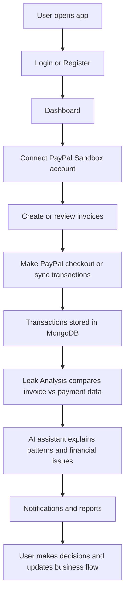
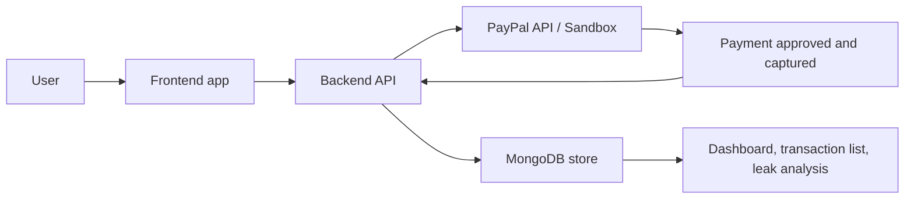

# PayLeak Project Overview

## What this application is

PayLeak is a merchant finance and payment intelligence web application designed to help a business understand where money may be leaking through invoices, transaction mismatches, payment fees, and operational inefficiencies.

The app combines:

- a secure dashboard for payment and invoice visibility
- PayPal sandbox integration for payment capture and reconciliation
- invoice creation and management
- leak analysis for financial discrepancies
- AI-driven explanations and insights
- notifications and settings for account operations

In short, this is not just a PayPal app or just an invoicing app. It is a financial control and analysis platform that uses PayPal transaction data and internal invoice records to help detect mismatches, explain charges, and improve financial visibility.

---

## Main purpose

The product is built around a simple business problem:

> A merchant may receive payments, create invoices, and track activity, but may not immediately know where money is lost, delayed, or mismatched.

PayLeak tries to solve that by:

- connecting to PayPal payment activity
- importing or recording transaction data
- comparing transactions with invoice records
- highlighting leaks or unusual patterns
- giving AI-powered explanations and recommendations
- helping the user act on alerts and dashboard insights

---

## Technologies used

### Frontend
- React
- Vite
- React Router
- Axios
- Recharts
- React Hot Toast
- Lucide React

### Backend
- Node.js
- Express
- TypeScript
- Mongoose
- MongoDB
- JWT for authentication
- bcrypt for password hashing
- Zod for validation

### Additional services
- PayPal REST API
- MongoDB Atlas / MongoDB database
- OpenAI-style AI service integration for assistant and financial explanations
- HTTP-only secure session patterns for auth

### Dev tools
- npm
- tsx for TypeScript execution
- Vite dev server
- Concurrent script runners for frontend + backend together

---

## How the app is structured

### Frontend
The frontend is the user-facing portal. It contains pages such as:

- Login and Registration
- Dashboard
- Connect PayPal
- Sandbox Checkout
- Transactions
- Invoices
- Create Invoice
- Leak Analysis
- AI Assistant
- Notifications
- Settings

This is where the user interacts with the platform visually.

### Backend
The backend exposes APIs and handles:

- login and signup
- JWT authentication
- database operations with MongoDB
- invoice management
- payment and transaction processing
- PayPal order creation and capture
- analytics and leak calculations
- AI-related requests
- notifications and reports

This is the logic and data layer of the platform.

### Database
MongoDB stores:

- users
- invoices
- payments
- transactions
- notifications
- route or fee-related data
- audit and analysis records

---

## Typical user flow



### Step-by-step flow

1. The user signs up or logs in.
2. The app authenticates them using JWT and stores a secure session.
3. User visits the dashboard to view financial activity.
4. User connects a PayPal sandbox account to enable payment integration.
5. User creates invoices or reviews existing invoice records.
6. PayPal checkout or transaction sync occurs through the backend.
7. The backend validates and stores transaction data in MongoDB.
8. The system compares payments, invoices, and fees to identify leaks or mismatches.
9. The AI assistant provides explanations for unusual activity or financial patterns.
10. Notifications and analysis reports help the user take action.

---

## How PayPal is related to this website

PayPal is a core part of the app because the platform is built around financial activity, merchant payments, and reconciliation.

The relationship is:

- the user connects their PayPal sandbox account
- the backend creates PayPal orders
- PayPal handles payment approval and capture
- the app confirms and stores the completed transaction
- the transaction is later compared with invoices and other records
- leak analysis uses that data to surface anomalies or money loss

### PayPal flow in this app



### Real-world logic

1. A user wants to complete a payment or simulate a transaction.
2. The frontend sends a request to the backend.
3. The backend creates an order using PayPal credentials.
4. PayPal redirects the buyer to the sandbox approval flow.
5. After approval, the backend verifies the payment and captures it.
6. The transaction is saved in MongoDB.
7. The system uses that stored data to analyze invoice and payment mismatches.

This makes PayPal the payment engine behind the platform’s financial intelligence layer.

---

## What problem this application solves

This app solves the problem of financial blind spots for merchants.

Typical issues it helps expose:

- invoice amount and payment mismatch
- missing or delayed payments
- suspicious transaction activity
- unexplained fees or leakage
- lack of clear explanation for payment behavior
- poor visibility across invoice and transaction records

So the product is essentially a business dashboard for monitoring money movement and explaining it clearly.

---

## How to run the project locally

1. Open the project root.
2. Install dependencies:

```bash
npm install
npm install --prefix frontend
npm install --prefix backend
```

3. Configure the backend environment file in `backend/.env`.
4. Use a valid MongoDB connection string and a secure JWT secret.
5. Start the app:

```bash
npm run dev
```

This starts the frontend and backend together.

---

## Summary

PayLeak is a merchant payment intelligence platform that combines:

- React frontend for user experience
- Express + TypeScript backend for logic and APIs
- MongoDB for persistence
- PayPal sandbox integration for payment workflows
- AI-based analysis for explaining finance-related issues

Its central idea is to help a business connect payments, invoices, and transaction data in one place and uncover where financial leakage or mismatch is occurring.
